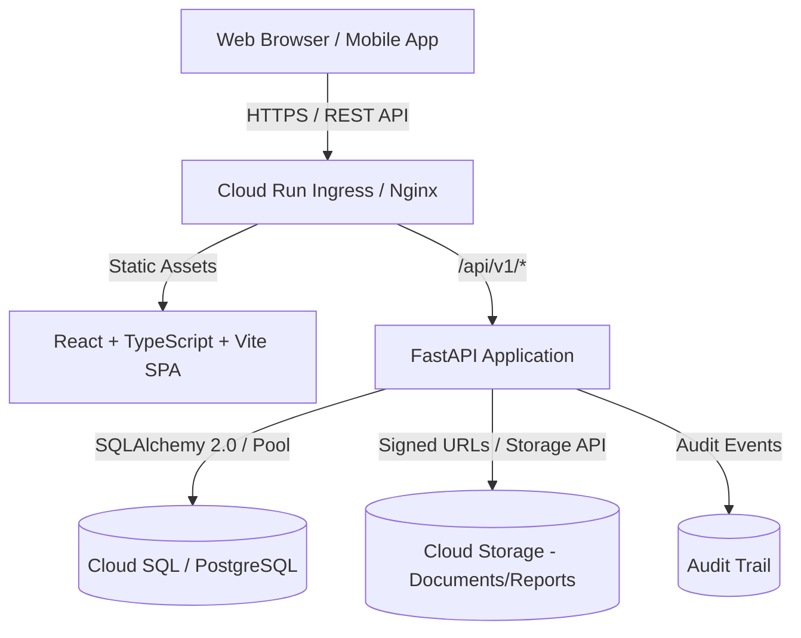
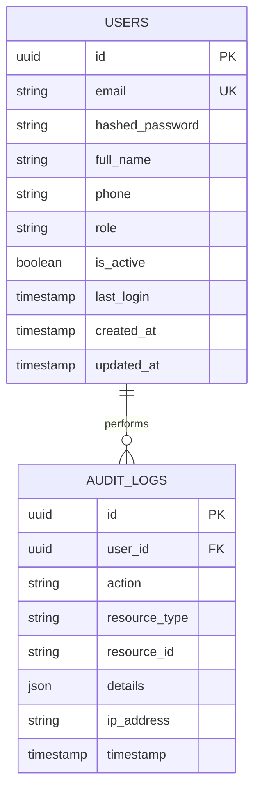

# School Management System — System Architecture

## 1. System Overview

The School Management System is a comprehensive web and mobile-ready platform designed for educational institutions to unify student admissions, academics, fee operations, examinations, attendance, communications, and institutional reporting.

## 2. Technology Stack & Component Design

| Tier | Technology | Purpose |
| :--- | :--- | :--- |
| **Frontend** | React 19, TypeScript, Vite, Tailwind CSS, React Router v6, Axios, Lucide Icons | Responsive SPA delivering role-based views (Admin, Principal, Accountant, Teacher, Parent, Student) |
| **Backend** | Python 3.13, FastAPI, Pydantic v2, SQLAlchemy 2.0, Alembic, PyJWT, Bcrypt | Asynchronous RESTful API layer under `/api/v1` with clean separation of Routers, Services, Schemas, and Models |
| **Database** | PostgreSQL (v16/v18) | Relational store with ACID guarantees, decimal currency precision, foreign key cascades, and unique constraints |
| **Containerization** | Docker, Docker Compose, Multi-stage builds | Uniform environments for local development and Google Cloud Run deployment |
| **Cloud Target** | Google Cloud Run, Cloud SQL, Cloud Storage, Secret Manager | Serverless horizontal scaling, managed backups, private object storage |

## 3. Security & Access Control Model

### 3.1 Authentication
- **Token Mechanism**: Dual-token standard. Short-lived JWT Access Tokens (30 minutes) + Rotating Refresh Tokens (7 days).
- **Password Security**: Salted Bcrypt hashing with configurable work factor (default: 12 rounds).
- **Transport Security**: HTTPS mandatory in production; CORS strictly configured to permitted client origins.

### 3.2 Role-Based Access Control (RBAC)
The system enforces strict multi-role authorization both at the API endpoint level and in the UI:

| Role | Core Responsibilities | Scope of Access |
| :--- | :--- | :--- |
| **ADMIN** | Full institutional administration | School-wide: users, classes, subjects, fee structures, settings |
| **PRINCIPAL** | Academic oversight & results approval | Academic reports, exam results approval, attendance monitoring |
| **ACCOUNTANT** | Financial management & billing | Fee structures, invoices, payment receipts, refunds, collection reports |
| **TEACHER** | Classroom operations & grading | Assigned classes/subjects, attendance registers, marks entry |
| **PARENT** | Child monitoring & fee payments | Strictly scoped to linked children (attendance, report cards, invoices) |
| **STUDENT** | Personal learning & schedules | Strictly scoped to personal records (grades, timetable, attendance) |

### 3.3 Record-Level Data Isolation
- Parent and Student access is verified server-side against child-guardian and enrollment mapping tables; client-supplied IDs are cross-checked against token claims.
- Completed financial receipts are immutable; adjustments occur only via controlled refund/reversal transactions.

## 4. API Architecture

All endpoints reside under `/api/v1` and follow standard REST conventions:
- `/api/v1/auth`: Authentication, login, refresh, profile, password changes
- `/api/v1/users`: User management and role assignments
- `/api/v1/academics`: Years, classes, sections, subjects, timetables (Phase 2)
- `/api/v1/students`: Admissions, enrollments, student records (Phase 2)
- `/api/v1/fees`: Fee structures, invoices, payments, receipts (Phase 3)
- `/api/v1/exams`: Exams, schedules, marks, results, report cards (Phase 4)
- `/api/v1/attendance`: Daily attendance, registers, corrections (Phase 5)
- `/api/v1/parent`: Linked child data endpoints (Phase 6)
- `/api/v1/student`: Personal student portal endpoints (Phase 6)
- `/api/v1/notices`: School-wide and targeted notifications (Phase 7)
- `/api/v1/reports`: PDF/Excel reporting and analytics (Phase 7)
- `/api/v1/audit`: Administrative audit trails

## 5. Database Schema Foundation (Phase 1)

